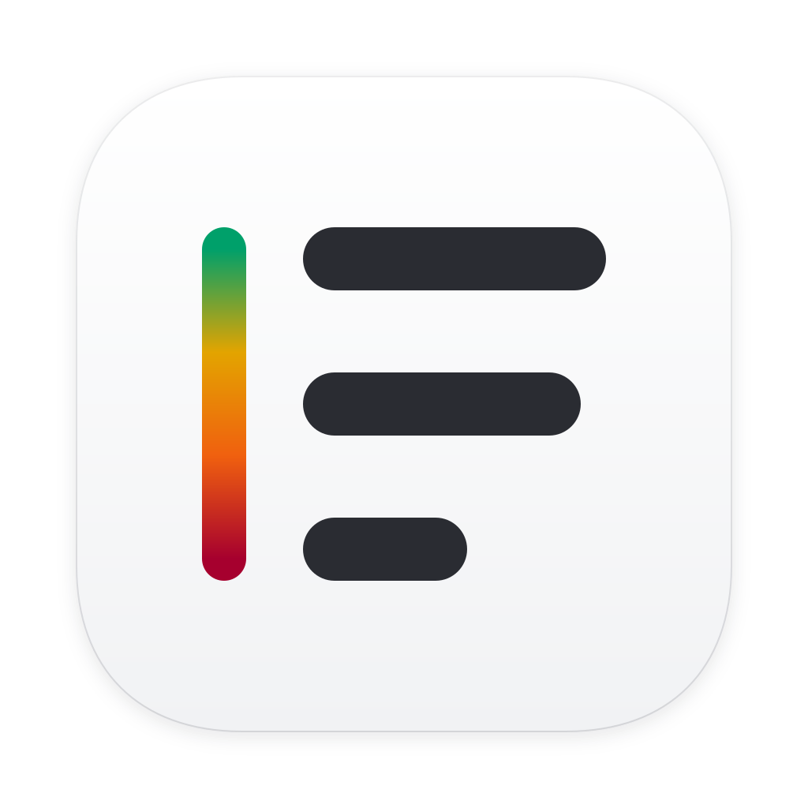

<picture>
  <source media="(prefers-color-scheme: dark)" srcset="assets/icon-dark.svg">
  
</picture>

# Anagram

Anagram marks English prose as human, AI-assisted or AI-generated. The selected detector
runs on your computer, inside the browser or in a local engine. On mixed passages, the
underline follows each sentence’s label.

[User guide](docs/user-guide.en.md) · [中文指南](docs/user-guide.zh-CN.md) · [Privacy](PRIVACY.md)

## Install

1. From the [latest release](https://github.com/CoderBak/anagram/releases/latest), download
   **anagram-chrome-&lt;version&gt;.zip** (Chrome 137 or later). If you choose the optional
   local engine during setup, its installer fetches the matching engine package.
2. Unzip it into a folder you will keep: Chrome runs the extension from there.
3. Open `chrome://extensions`, turn on **Developer mode** (top right), click **Load unpacked**
   and choose that folder.
4. The setup page opens with three numbered steps, each ticked off once it is done. First
   choose a detector if several are available. Setup preselects the recommended model and shows its download size.
   On an Apple Silicon Mac or a Linux PC with an NVIDIA graphics card, choose **In-browser engine**
   or **Local engine**. The local engine's install command sets up a private Python runtime,
   registers the extension and downloads the model files. You can switch engines in Settings.
5. Then where it reads (**Allow all sites**, or one site at a time from the toolbar menu),
   and pinning Anagram to the toolbar. Without a grant, **Analyze this page** in the toolbar
   menu reads the page in front of you once.

Apple Silicon Macs are the tested platform. Linux and Windows installers exist but have
not been exercised on real machines. Firefox 153+ has a build but is not the focus.

The Safari version targets **Mac computers with Safari 27+**. It shares the recommended
**In-browser engine** and optional **Local engine** with Chrome and Firefox.
The browser engine needs a compatible WebGPU adapter and uses a pinned engine tab;
the separate engine needs a full Safari app build and an Apple Silicon Mac. Build and
real-Mac verification instructions are in [Development](docs/DEVELOPMENT.md#safari).
Safari runtime verification is pending.

## Use

A paragraph’s chip shows its dominant label. Hover or focus the chip to see the share of
text in each class and the individual sentence labels. The score adds the AI-generated
share and half the AI-assisted share. Human is green, AI-assisted is amber and
AI-generated is crimson.

Open the toolbar menu for the page summary and flagged paragraphs. Select a paragraph
to jump to it. On Google Docs, choose **Analyze document** to open the reading view.
PDFs open in the built-in reader. Settings controls site access, marks, history and the engine.
Older reading history keeps its original lightly edited and heavily edited labels.

## Develop

```sh
npm ci
npm run build          # output/chrome-mv3
npm run typecheck
npm run test:node
```

See [docs/DEVELOPMENT.md](docs/DEVELOPMENT.md) for the code map, the full check list
and open work.

## Model and license

Anagram's code is licensed under the [GNU AGPL v3.0 or later](LICENSE). The third-party
work it ships or adapts keeps its own licences, listed in
[THIRD_PARTY_NOTICES.md](THIRD_PARTY_NOTICES.md).

Models are published in [CoderBak/anagram-detectors](https://huggingface.co/CoderBak/anagram-detectors).
Setup reads the recommended detector from the Hugging Face `default` branch. Settings → Engine → Check for models lists dated branches and tags, for example
`2026-11-14-400m-research`. Choose a release to download it. Each engine verifies its files and runs locally.
The detector was inspired by Pangram 4. Its reading card shows sentence-level authorship labels.
The initial release reads English passages of at least 50 words and reports the shares labeled human,
AI-assisted and AI-generated.

To publish another checkpoint, use a dated branch or tag such as `2026-11-28-400m-ettin_research` or
`2026-11-28-0.8b-qwen3.5_research`. Keep the matching release’s `anagram-detector/1` file layout,
tokenizer, three heads and CRF. Both engines read the original safetensors directly. They support the
ModernBERT FP32 backbone used by Ettin and the Qwen3.5 0.8B text backbone with BF16 weights and two copies of each window.
Point the Hugging Face `default` branch at the checkpoint you want setup to recommend.
Open the model link in Settings to see the files, documentation and terms published for that revision.
